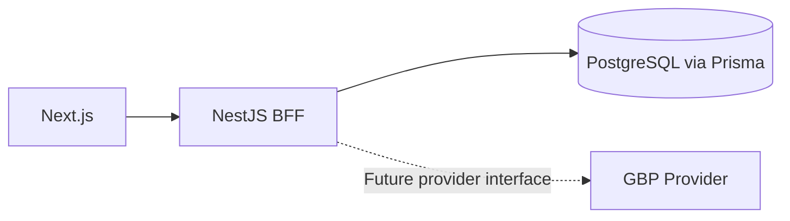

# Phase 1 architecture

The npm workspace contains `apps/web`, `apps/api`, and `packages/contracts`.
Next.js owns frontend rendering and its build system. NestJS owns the API and
will be the security boundary. Shared contracts describe public application
responses, independently of database models.

PostgreSQL runs locally through Docker Compose. Prisma connects during API
startup and disconnects on shutdown. Identity tables and an initial migration are present; the application-session foundation is implemented. `GET /health` is a liveness endpoint returning `{ "status": "ok" }`; it does
not perform a database readiness query on every request.

Local API CORS permits only `http://localhost:3000`, with credentials enabled for BFF requests.
CORS controls browser access and does not authenticate or authorize callers.
Both application servers and the database port bind to loopback for this local
bootstrap. API logs suppress framework startup errors and report only a generic
failure to avoid printing database credentials.

Google GBP reads and per-user encrypted offline connections are implemented; Google writes remain read-only. Bounded bulk updates and mock writes for the seven supported fields are implemented. Large background jobs, queueing, retry/backoff, Redis and BullMQ belong to Phase 2. Google tokens remain server-side, and the browser uses an opaque HttpOnly application-session cookie.
MockBusinessProfileProvider is the default provider. GoogleBusinessProfileProvider implements the same BusinessProfileProvider interface.

Prisma packages are pinned together at 6.19.3. The root dependency override
selects patched `deepmerge-ts` 8.0.2 for Prisma CLI configuration; generation
and builds validate that configuration path.

## Contracts and identity schema

Shared types define application-owned views, not Prisma or Google response
objects. Location statuses are OPEN, TEMPORARILY_CLOSED, and PERMANENTLY_CLOSED;
updates allow websiteUrl, primaryPhone, additionalPhones, regularHours, specialHours, description, labels and normalized serviceItems. Null clears scalar values; empty arrays clear lists. Bulk labels use add/remove operations.
Pagination uses one-based page numbers. The strict shared Zod update schema validates requests again in the service.
VIEWER grants location:read; MANAGER also grants location:write. PATCH uses a
NestJS permission decorator/guard and service policy, with mock provider checks
as defense in depth. /api/me derives permissions from the persisted membership;
the UI uses those capabilities only to control presentation. Missing membership denies access.
Account entitlements come from a server-owned lookup by authenticated user ID.
The current mock application grants account-1 to authenticated users; account-2
is an out-of-scope fixture for negative tests. In Google mode, owned GoogleBusinessConnection records resolve tokens and live accounts.list resolves account entitlements.
The service checks list account IDs and the actual account of detail/write resources.

OAuthConnection permits one connection per provider per user and uniquely binds
a provider subject for identity login. GoogleBusinessConnection separately allows multiple Business grants per user and stores encrypted refresh tokens. Session stores a 64-character hash
for a future SHA-256 session-token digest; raw cookies/tokens must never be stored
in this table. UUID user IDs, unique email, foreign keys, and cascading user deletion
keep identity records consistent. There are no persisted accounts/locations.
The explicitly enabled local-login path creates an initial VIEWER fixture; no global
seed or production demo user is installed.

## Normalized errors

The global HTTP filter returns ApiError directly: code, fixed public message,
requestId, and nullable details. Each request gets a server-generated UUID in
X-Request-Id, also exposed through local CORS. Client request IDs are ignored.
AppException selects the explicit domain code and status; only validation errors
may supply application-owned field names and fixed violation reasons. Never pass
request values, provider responses, or exception messages as details.

Nest 400/422, 401, 403, and 404 errors map to validation, authentication, permission,
and not-found codes. Unexpected errors use INTERNAL_ERROR (500), an additional
code needed to avoid misclassifying application/database failures as provider errors.
Provider failures require explicit domain classification (502/429); an arbitrary
HTTP 429 is not assumed to come from Google. Raw errors, stack traces, and exception
messages are suppressed in every environment. No raw exception logging is added.

To check manually, request GET /missing: expect HTTP 404, RESOURCE_NOT_FOUND,
a UUID matching X-Request-Id, and details: null. GET /health remains unchanged
and now also carries the request ID header. Database migration application requires
a running local PostgreSQL; generation and HTTP tests do not.

## Mock provider

BusinessProfileProvider lives in the API and returns application contracts only.
BusinessProfileModule defaults to one process-scoped MockBusinessProfileProvider;
GoogleBusinessProfileProvider implements the same contract. Google mode resolves an owned connection and binds its provider into the server-created UserContext; mock remains the default.

The mock creates two accounts and 1,000 locations by default. Set the optional
MOCK_LOCATION_COUNT in apps/api/.env to an integer from 1,000 to 10,000 (total
across both accounts). Stable IDs, round-robin account assignment, numeric ordering,
operating state, and verification state make independent fixtures reproducible.
Search matches name/address case-insensitively; status filtering precedes pagination.
Pages are one-based, pageSize is 1-100, and pages beyond the result return empty items
with the filtered total. Updates validate the supported normalized fields before
changing any record, persist until restart, and return detached snapshots.

Unit fixtures select normal, unauthenticated, forbidden, notFound, rateLimited,
providerError, networkError, or pendingVerification via constructor options. Error
scenarios apply to every operation; network errors normalize to PROVIDER_ERROR.
No scenario toggle is exposed through HTTP. VerificationStatus (VERIFIED/PENDING)
is separate from operating status and is present in summaries and details.

BusinessProfileController exposes authenticated GET /api/accounts,
GET /api/accounts/:id/locations, and GET /api/locations/:id. SessionGuard constructs
identity from the durable application session. Server-owned mock entitlement scope
currently grants signed-in VIEWER/MANAGER users the two fictional fixture accounts;
no account scope is accepted from the browser. This is a mock-only entitlement policy,
not authorization for real Google accounts. Replace BUSINESS_PROFILE_SCOPE with
provider-backed per-user entitlement resolution before enabling a real GBP provider.
BusinessProfileService verifies accessible accounts before calling listLocations,
whose provider interface intentionally has no context argument. Detail reads enforce
scope in the provider. See [read flows](read-flows.md) for validation and UI behavior.

## Web foundation

Next.js App Router uses a public /login route and a (protected) route-group layout
for /app. The group name is organizational, not an access check. SessionBoundary
bootstraps through GET /api/me and gates the shell for UX. NestJS SessionGuard
protects /api/me and must be applied to every future private API route. The root
redirects to /login. No sensitive server-rendered data is placed inside the client
boundary; private server-rendered pages will require server session verification.

A QueryClientProvider owns a client per mounted provider rather than a module-level
shared cache. Default staleTime and mutation retry behavior remain unchanged;
queries skip retry for HTTP 4xx and keep the usual three retries for transient errors.
Server data belongs in Query cache. Dialogs, selected rows, and active tabs belong
in component state when introduced; no persistent browser storage is used. Baseline
keys cover me, accounts, filtered account locations, and individual location detail.
The me query and local-login/logout mutations use the BFF. No location endpoints
are called. Login and logout clear other user caches and cancel pending requests.

The browser BFF client sends credentials: include, supports AbortSignal, prevents
cross-origin paths/redirects, and requires a decoder for typed success data. Error
payloads are validated and mapped to BffError containing ApiError plus HTTP status.
Malformed bodies and network errors use a generic safe fallback; a missing request
ID is represented by unavailable. Raw transport payloads are never displayed.
NEXT_PUBLIC_BFF_ORIGIN optionally configures the non-secret API origin, defaulting
to http://localhost:3001. CORS remains restricted to http://localhost:3000 and now
allows credentials. Session cookies and origin-checked auth mutations are implemented as described below.
No provider tokens or browser token storage are introduced.

Manual check: run npm run dev, visit /login then /app. The overview shows API status
ok when the BFF is reachable. Stop the API to see the reusable error/retry state;
loading is visible while the health request is pending. npm test runs web transport
and query-key tests alongside the API tests.

## Durable application sessions

POST /auth/dev-login is a deliberately local-only authentication bypass. It is off
by default and only runs when LOCAL_DEV_LOGIN_ENABLED=true, NODE_ENV is development
or test, and WEB_ORIGIN is loopback. Production always disables it. The API dev script
sets NODE_ENV=development; the API start script sets NODE_ENV=production. Custom
production deployments must also explicitly set NODE_ENV=production.
The web login button independently requires the same flag in its server environment
and next dev; UI visibility is not security enforcement. No submitted user ID or role
is trusted. The fixture initially has VIEWER; existing database membership is authoritative.

A fresh 256-bit random opaque ID goes only into Set-Cookie. Its SHA-256 hash, user
foreign key, and absolute eight-hour expiry are stored in PostgreSQL. Login rotates
the presented session in the same transaction as creation; /api/me reads current
membership from the database, so missing membership fails closed. The guard returns
UNAUTHENTICATED for missing/unknown/revoked cookies and SESSION_EXPIRED for a known
expired session. Expired rows are retained for this distinction; periodic cleanup
is deferred. Browsers may remove an expired cookie themselves, which then appears
as UNAUTHENTICATED. Authenticated logout requires exact Origin and session-bound CSRF proof, deletes
the server record, and clears the cookie with matching scope. Missing/expired
sessions return 401.

Cookies are always HttpOnly, host-only, Path=/, and explicitly SameSite=Lax. Local
HTTP uses gbp_session without Secure; HTTPS uses Secure and __Host-gbp_session.
WEB_ORIGIN defines the deployment scheme/origin, and production rejects HTTP.
Web and BFF must be deployed on the same site over HTTPS (for example behind one
reverse proxy); cross-site cookies/SameSite=None are outside this foundation.
The app does not trust client-provided forwarded protocol headers. State-changing
requests require an exact Origin match to WEB_ORIGIN, complementing SameSite and
credentialed explicit-origin CORS. Responses are no-store. No session IDs are
returned in JSON, accepted as bearer headers, or logged.

The application cookie identifies a session in our database. It cannot call Google
and carries no Google permissions, access token, or refresh token. Google login tokens are transient server-only values; secure-at-rest offline
credential persistence uses GoogleBusinessConnection behind the BFF/provider boundary. Browser JavaScript sees only UserView
and role/permissions through /api/me, not the HttpOnly cookie value.

NextJS keeps UserView in TanStack Query under ['me']; there is no localStorage or
sessionStorage authentication. Unauthorized visitors redirect to /login; known
expired sessions show a dedicated sign-in-again message. Other failures show an
error/retry state and do not pretend the user is signed out. Client gates are UX
only; private requests are authorized on the server. Account-scoped authorization endpoints, cleanup jobs, and server-rendered private
page verification remain deferred. Session, User, and Membership use the initial
identity migration; Google login adds OAuthTransaction, and Business connections add GoogleBusinessConnection and GoogleBusinessOAuthTransaction.

## Google identity login

Google OAuth/OIDC now runs exclusively in NestJS and creates the same PostgreSQL
application session as local login. OAuthTransaction stores only expiring state,
browser-binding, and nonce hashes, with atomic one-time consumption. No provider
token fields are added. Account identity is matched by Google sub; email collisions
require explicit future linking. New memberships default to VIEWER; existing roles
remain authoritative. See [auth-flow.md](auth-flow.md) for the sequence diagram,
PKCE/state/nonce rationale, callback validation, deployment logging, and deferred
offline access.

## CSRF and CORS hardening

See [csrf-cors.md](csrf-cors.md). Mutations use durable session validation, exact
Origin, and session-bound HMAC proof obtained from GET /api/csrf. The web client
attaches X-CSRF-Token automatically; logout uses the same policy. Public health
requests omit credentials. CORS reflection is isolated in a disabled-by-default
LOCAL LAB ONLY module and cannot be enabled by production configuration.
