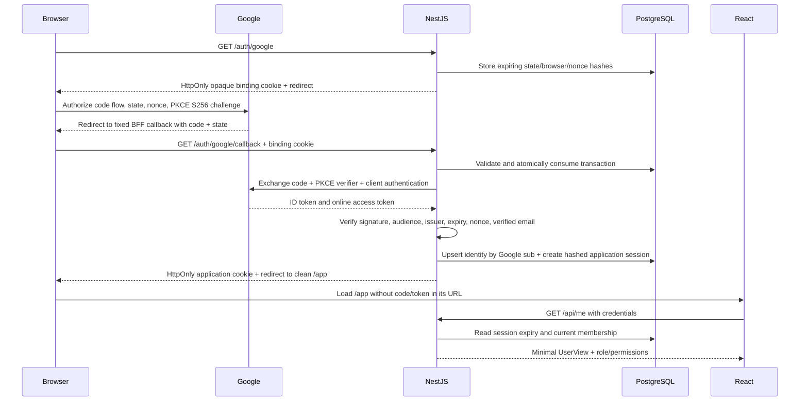

# Google login and application sessions



## Configuration and manual test

Create a Google OAuth client of type Web application in Google Cloud. Configure
its consent screen and permitted test users as required by your Google project.
Register the exact authorized redirect URI:
`http://localhost:3001/auth/google/callback` for local development. Put these
values only in `apps/api/.env`:

```dotenv
GOOGLE_OAUTH_CLIENT_ID=replace_me
GOOGLE_OAUTH_CLIENT_SECRET=replace_me
GOOGLE_OAUTH_REDIRECT_URI=http://localhost:3001/auth/google/callback
```

The API defaults to Google login disabled when all three are absent. Partial or
unsafe configuration fails startup with a generic error. No real credentials
belong in committed example files. The web needs only the public BFF origin and
uses a top-level navigation to `/auth/google`, never an OAuth token request.

Apply the migration with `npm run db:migrate`, then run `npm run dev`. Visit
`http://localhost:3000/login`, select Sign in with Google, and finish consent.
Expect a clean `/app` URL and a subsequent `/api/me` request. Confirm that only
id, email, displayName, role, and permissions reach React. Restart the API and
refresh: the application session persists. Sign out to revoke the database session.

In production set WEB_ORIGIN to the HTTPS web origin and register an HTTPS BFF
callback on the same hostname (ports may differ). Callback path must be exactly
`/auth/google/callback` with no query, fragment, credentials, or dynamic return URL.
Only explicit development/test loopback deployments permit HTTP. Keep the web and
BFF on the same site; cross-site cookies are not part of this flow.

## State, PKCE, and nonce

State is a random 256-bit value that correlates a callback with a specific browser
attempt and protects against login CSRF. PostgreSQL stores its SHA-256 hash and a
separate hash of the random HttpOnly browser-binding cookie. A state value alone
is insufficient: the correct browser cookie must also be present. The transaction
expires after ten minutes and is atomically deleted before code exchange, making
valid callbacks single-use across API instances. Starting a new attempt removes
the browser's previous pending attempt. This is a single-pending-attempt design;
parallel login tabs are not supported.

PKCE protects an intercepted authorization code from redemption without the
transaction's verifier. Google advertises S256 support. This confidential web
client uses S256 in addition to its server-only client secret; PKCE does not replace
client authentication or state. The 43-character verifier is derived with a
domain-separated HMAC-SHA256 of the random state using the server client secret.
Only its SHA-256 challenge is sent in the authorization request. The verifier is
recomputed server-side at exchange, avoiding plaintext verifier storage in cookies
or PostgreSQL and allowing pending flows to survive API restarts. Rotating the
client secret invalidates pending attempts, so users must restart login.

OIDC nonce binds the signed identity token to the same transaction and resists
identity-token replay/substitution. Its hash is stored with the transaction and
compared after signature verification. State, PKCE, and nonce serve different
checks; all three are validated before a local session is created.

The implementation follows Google's [OIDC server flow](https://developers.google.com/identity/openid-connect/openid-connect)
and uses the official [Node authentication library](https://github.com/googleapis/google-auth-library-nodejs).
Google's [discovery document](https://accounts.google.com/.well-known/openid-configuration)
advertises S256 and the fixed authorization/token/issuer endpoints.

## Identity and tokens

The official SDK verifies Google's ID-token signature, issuer, audience, and token
lifetime. The application additionally checks exact audience/authorized presenter,
issuer, non-expired exp, nonce, nonempty sub, and verified email. Decoding an unsigned
JWT alone is never sufficient.

Google sub, scoped by provider=google, is the identity key. A new verified identity
gets a local User, OAuthConnection, and initial VIEWER membership. Later login updates
the profile and observed granted scopes while preserving the stored membership role.
A matching email alone does not automatically link a Google identity to an existing
local/other-provider user: the callback fails closed. Explicit account linking is
future work. User/profile/connection/session writes and replacement of the presented
application session occur in one PostgreSQL transaction.

Only openid/email/profile are requested, with access_type=online and no incremental
business permissions. Access and ID tokens exist only transiently in the BFF for
exchange/verification and are then discarded; they are never stored in browser
storage, cookies, session rows, public contracts, or OAuthConnection token columns.
An unexpected refresh token is also discarded. Offline access, secure-at-rest refresh
storage (for example envelope encryption with managed keys), token refresh, and real
GBP API authorization remain deferred. Google login therefore does not yet grant
business-profile access or enable background provider work.

The browser's application cookie is a fresh opaque random ID, unrelated to Google's
access token. Its hash is stored in our Session table and is accepted only by our BFF.
It cannot authenticate to Google. Cookie policy stays HttpOnly, host-only, Path=/,
SameSite=Lax, and Secure for HTTPS. The temporary binding cookie has the same policy
and a ten-minute lifetime; it contains no code, nonce, verifier, or Google token.

## Failure handling and logging

Missing/invalid/expired/replayed state, wrong/missing binding cookie, malformed or
duplicated query fields, unexpected callback parameters/issuer, denial, token exchange
failure, invalid identity, and account collisions never create a session. Callback
failures clear the binding cookie and redirect to the fixed clean `/login` route;
raw Google errors and callback values are never rendered. An existing valid application
session is preserved on failure. Successful callbacks redirect only to fixed `/app`.

Responses use no-store and Referrer-Policy: no-referrer. No application logging of
codes, tokens, secrets, cookies, authorization headers, or exception objects is added.
Deployment access logs/tracing must also redact OAuth callback query strings, request
cookies/authorization headers, and token-exchange bodies; do not enable SDK HTTP debug
logging. Never paste full callback URLs or cookie values into issues or screenshots.

Dev login remains independently disabled by default and forbidden in production.
Deterministic tests use an explicit test-only Google gateway, local signing fixtures,
and test stores; no real Google account or network authorization is needed. Optional
PostgreSQL tests exercise single-use transactions, identity persistence, role preservation,
email-collision rejection, and atomic session creation. Real consent must be checked
manually with your Google project credentials.

Run deterministic tests with `npm test`. To include the local PostgreSQL cases:

```bash
RUN_SESSION_DB_TESTS=true NODE_ENV=test npm exec -w @gbp/api -- tsx --test test/google-oauth.database.test.ts test/session.database.test.ts
```

Google database fixtures use unique test subjects/emails and delete only their own
users afterward. The existing local-login fixture remains intact. Apply migrations
first; run these tests only against a loopback local/test database.
